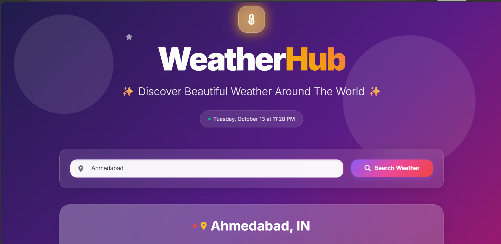
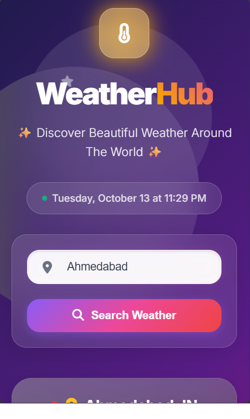

# 🌤️ Weather App - Full Stack Application

A sleek, responsive, and interactive weather web app built with a **Spring Boot** backend and a **modern HTML/CSS/JavaScript** frontend. Designed with a beautiful **glassmorphism** UI and real-time weather updates using OpenWeatherMap API.

🔗 **Live Demo:** placholder


---

## 🌟 Features

- 🎨 **Modern Glassmorphism UI**
- 🌍 **Search any city worldwide**
- 🌓 **Dynamic background (day/night)**
- 💨 **Displays temperature, humidity, wind speed, visibility**
- 📱 **Mobile responsive design**
- 🔁 **Smooth animations and transitions**
- 🚀 **Real-time weather data via OpenWeatherMap**
- ⚡ **Quick city search buttons**
- 🎯 **Fast, lightweight & intuitive interface**

---

## 🛠️ Tech Stack

### 🔹 Backend
- **Spring Boot 3.2.0**
- **Java 17**
- **Maven**
- **RestTemplate** (for external API calls)
- **Jackson** (JSON parsing)

### 🔹 Frontend
- **HTML5 + CSS3**
- **JavaScript (ES6+)**
- **Google Fonts + Font Awesome**
- **Glassmorphism Design Pattern**

### 🔹 API Used
- [OpenWeatherMap](https://openweathermap.org/api)

---

## 📸 Screenshots

### 🌐 Desktop View
> *Glass-like card with animated weather info*



### 📱 Mobile View
> *Fully responsive on smartphones and tablets*



---

## 🚀 Live Demo

🟢 **Try the app now:**  
👉 [placeholder](link)

---

## 🏃‍♂️ Quick Start Guide

### ⚙️ Prerequisites

- Java 17+
- Maven 3.6+
- OpenWeatherMap API key (free at [openweathermap.org](https://openweathermap.org/api))

### 📥 Installation

1. Clone the project:
   ```bash
   git clone https://github.com/mahekbagwan63-coder/weather-app.git
   cd weather-app
   ```

2. Add your API key in `application.properties`:
   ```properties
   openweather.api.key=${OPENWEATHER_API_KEY}
   ```

   Or set it as an environment variable:
   ```bash
   export OPENWEATHER_API_KEY=your_key_here
   ```

3. Run the application:
   ```bash
   mvn spring-boot:run
   ```

4. Visit the app:
   ```
   http://localhost:8080
   ```

---

## 🌐 Deployment

🟣 **Hosted on:** [Railway](https://railway.app)

### Railway Setup
- Connect GitHub repo
- Add environment variable `OPENWEATHER_API_KEY`
- Set start command:
  ```bash
  java -jar target/weather-app-0.0.1-SNAPSHOT.jar
  ```

---

## 📂 Project Structure

```
weather-app/
├── src/
│   └── main/
│       ├── java/com/example/weatherapp/
│       │   ├── WeatherAppApplication.java
│       │   ├── controller/WeatherController.java
│       │   ├── service/WeatherService.java
│       │   └── model/WeatherResponse.java
│       └── resources/
│           ├── application.properties
│           └── static/
│               ├── index.html
│               ├── styles.css
│               └── script.js
├── pom.xml
├── README.md
```

---

## ✨ Future Enhancements

- 🔔 Add location-based weather using geolocation
- 🌦️ Weekly forecast view
- 🧊 Theme switcher (light/dark)
- 🗺️ Interactive weather map view

---

## 🙌 Acknowledgments

- [OpenWeatherMap](https://openweathermap.org/)
- [Railway](https://railway.app)
- [Font Awesome](https://fontawesome.com/)
- [Google Fonts](https://fonts.google.com/)
- [Spring Boot](https://spring.io/projects/spring-boot)

---

## 💡 Author

Made with ❤️ by **[Mahek](https://github.com/mahekbagwan63-coder)**  
🚀 Star the repo if you like it!
